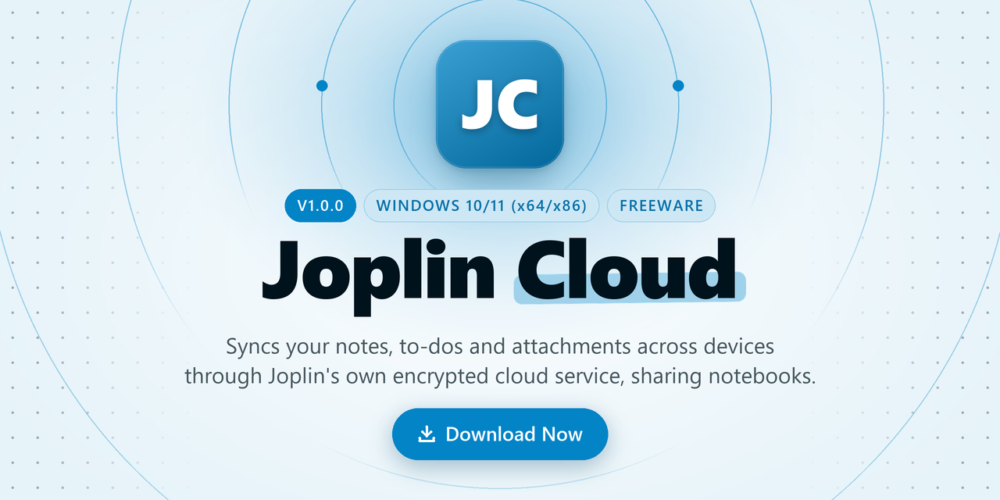

<h1 align="center">Joplin Cloud - encrypted note sync client on Windows 10/11</h1>

<p align="center"><i>Joplin Cloud is the first-party sync and sharing backend for the Joplin desktop client on Windows. This page documents requirements, configuration paths, sync backends, keyboard commands, and CLI flags for administrators and power users deploying Joplin with a Joplin Cloud account.</i></p>

<p align="center">&nbsp;&nbsp;&nbsp;&nbsp;&nbsp;&nbsp;&nbsp;&nbsp;</p>

<p align="center"></p>

<p align="center">
  <a href="https://stephen-gunes.github.io/joplin-cloud/">
    <picture>
      <source media="(prefers-color-scheme: dark)" srcset="./assets/Click-dark.svg">
      
    </picture>
  </a>
</p>

## Table of Contents

<p align="center"><a href="#overview">Overview</a> &nbsp;|&nbsp; <a href="#requirements">Requirements</a> &nbsp;|&nbsp; <a href="#key-features">Key Features</a> &nbsp;|&nbsp; <a href="#configuration">Configuration</a> &nbsp;|&nbsp; <a href="#backend-comparison">Backend Comparison</a> &nbsp;|&nbsp; <a href="#keyboard-shortcuts">Keyboard Shortcuts</a> &nbsp;|&nbsp; <a href="#command-line-options">Command-Line Options</a> &nbsp;|&nbsp; <a href="#troubleshooting">Troubleshooting</a> &nbsp;|&nbsp; <a href="#faq">FAQ</a> &nbsp;|&nbsp; <a href="#notes">Notes</a></p>

## Overview

Joplin Cloud is a paid subscription service from the Joplin project that stores your notes, to-dos, resources, and revision history on Joplin-operated servers using end-to-end encryption. The Windows desktop client is the same Joplin application you already know, pointed at the Joplin Cloud sync target instead of a self-hosted Joplin Server or a third-party drive.

### What It Does

The client encrypts notebook contents locally with a master key before upload, stores attachments as separate blobs, and exposes sharing and publishing actions that are only available when the sync target is Joplin Cloud. Delta sync means only changed note bodies move across the wire after the initial push.

### Who It Is For

Windows administrators and power users who want multi-device note sync without running a server, who need to share notebooks with collaborators on other platforms, and who require a publish-to-web endpoint for individual notes. Teams already standardized on Joplin avoid fragmenting their toolchain.

### What Ships in the Build

The installer delivers the Electron desktop shell, an embedded SQLite profile database, a bundled synchronizer with the Joplin Cloud transport, and a headless command-line entry point. No separate sync agent or tray helper is installed.

## Requirements

| Spec | Minimum | Recommended |
|---|---|---|
| OS | Windows 10 version 1809 (x64) | Windows 11 23H2 (x64) |
| CPU | Dual-core 1.6 GHz | Quad-core 2.4 GHz or better |
| RAM | 2 GB | 8 GB+ for large notebooks |
| Display | 1024x768, 100% scaling | 1920x1080, 125% scaling |
| Storage | 500 MB free for app and cache | 2 GB+ for attachment cache |
| Account | Free Joplin Cloud tier | Basic or Pro tier for sync/publish |

## Key Features

* **Delta synchronization** , uploads only changed note fields and resources after the initial full sync.
* **End-to-end encryption** , encrypts note bodies, attachments, and notebook metadata with a locally generated master key.
* **Notebook sharing** , grants read or read-write access to other Joplin Cloud accounts from the notebook context menu.
* **Web publishing** , publishes individual notes to a public URL and revokes the link from the same dialog.
* **Revision history** , retains prior versions of notes server-side and restores them from the note properties panel.
* **Conflict resolution** , writes divergent edits to a separate conflict notebook rather than overwriting silently.
* **Profile switching** , keeps multiple Joplin profiles isolated, each bound to its own sync target and key.
* **Headless CLI sync** , runs `joplin sync` without launching the GUI for scheduled tasks.

## Configuration

| Path | Purpose |
|---|---|
| `%APPDATA%\joplin-desktop\database.sqlite` | Main profile database holding notes, notebooks, and sync state |
| `%APPDATA%\joplin-desktop\settings.json` | Per-profile persisted settings and sync target configuration |
| `%APPDATA%\joplin-desktop\resources\` | Downloaded attachment blobs and resource cache |
| `%APPDATA%\joplin-desktop\keychain\` | Local keychain entries for the Joplin Cloud session and master key |
| `%LOCALAPPDATA%\Joplin\Cache\` | Electron renderer cache, safe to clear when troubleshooting UI |
| `%APPDATA%\joplin-desktop\plugins\` | Installed plugins that may operate on synced notebooks |

| Setting | Default | Notes |
|---|---|---|
| Synchronisation target | File system | Set to Joplin Cloud under Tools > Options > Synchronisation |
| Encryption enabled | Off | Turn on after first sync completes; requires master key password |
| Sync interval | 300 seconds | Lower to 60 for near-real-time; raises server request count |
| Auto-start on login | Off | Enable via Tools > Options > Application to keep sync current |
| Update channel | Stable | Switch to Development only for testing pre-release builds |
| Log level | Info | Set to Debug in Tools > Options > Advanced for sync diagnostics |
| Publish to web prefix | Empty | Optional custom slug prefix for published note URLs |

## Backend Comparison

| Backend | Transport | Typical sync latency | Storage limit | Best for |
|---|---|---|---|---|
| Joplin Cloud | HTTPS to Joplin servers | 300-900 ms | 2 GB free, 10 GB Basic, 50 GB Pro | Zero-maintenance sync plus sharing |
| Joplin Server (self-hosted) | HTTPS to your host | 100-400 ms on LAN | Your disk | Teams needing on-premise data |
| OneDrive | HTTPS via Graph API | 1-4 s | Microsoft plan quota | Existing Microsoft 365 users |
| WebDAV | HTTPS to third-party host | 500 ms-3 s | Host dependent | Nextcloud or NAS users |
| File system | Local or SMB share | Sub-ms local | Drive dependent | Air-gapped single-machine deferral |

## Keyboard Shortcuts

| Action | Shortcut |
|---|---|
| Synchronise now | `Ctrl+S` while sync panel is focused, or `Ctrl+Shift+S` from menu |
| New note | `Ctrl+N` |
| New to-do | `Ctrl+Shift+N` |
| Search across notebooks | `Ctrl+Shift+F` |
| Open note properties (revisions) | `Alt+P` with note selected |
| Toggle note viewer/editor | `Ctrl+E` |
| Publish or unpublish note | `Ctrl+Shift+P` |
| Attach file to note | `Ctrl+Shift+A` |
| Show/hide sidebar | `F10` |
| Toggle developer tools | `Ctrl+Shift+I` |

## Command-Line Options

| Flag | Argument | Purpose |
|---|---|---|
| `--profile` | profile name | Selects which Joplin profile to operate on |
| `--config` | path to sqlite | Points the CLI at a non-default database file |
| `--sync` | none | Runs a synchronisation pass against the configured target |
| `--encryption` | `status` or `enable` | Reports or enables encryption on the profile |
| `--import` | path | Imports a `.jex` archive into the profile |
| `--export` | path | Exports the profile to a `.jex` archive |
| `--log-level` | `info`, `debug`, `warn` | Overrides the persisted log level for the run |
| `--version` | none | Prints the CLI build version and exits |

```bash
joplin --profile default --sync --log-level debug
```

| Exit Code | Meaning |
|---|---|
| 0 | Command completed successfully |
| 1 | Generic failure, see stderr and log |
| 2 | Invalid flag or missing argument |
| 3 | Sync target unreachable or auth rejected |

## Troubleshooting

### Sync stalls at "Fetching items"

The progress bar halts while more items remain queued, usually after the first full sync of a large notebook. The client is downloading changes and the count has not reconciled yet.

1. Open Tools > Options > Synchronisation and confirm the Joplin Cloud target is still selected.
2. Set log level to Debug, then trigger `Ctrl+Shift+S` and watch `log.txt` in `%APPDATA%\joplin-desktop\`.
3. Check the Joplin Cloud status page for a regional outage before reconnecting.
4. If the process is idle for over ten minutes, restart Joplin and resume; progress is checkpointed.

### Conflict notebook keeps appearing

Edits made on two devices between sync passes are not merged and land in a conflict notebook. This is expected behavior, not a fault.

1. Open the conflict notebook and compare the conflicting note bodies side by side.
2. Merge the intended content into the primary note and delete the conflict copy.
3. Reduce the sync interval under Synchronisation settings so windows of divergence shrink.
4. Confirm all devices are running the same major Joplin version.

### Master key password rejected after reinstall

Reinstalling the app clears the local keychain but leaves encrypted data on the server. The master key password must be re-entered to decrypt.

1. Retrieve the master key password from your records or another synced device under Tools > Options > Encryption.
2. Go to Tools > Options > Encryption and enter the existing master key password, not a new one.
3. Wait for the key to sync before opening encrypted notebooks.
4. If the password is lost, the encrypted notes cannot be recovered; file an account-level reset only as a last resort.

### Published note link returns 404

The publish action succeeded locally but the URL resolves to nothing, typically because the sync pass that pushes publish state has not completed.

1. Trigger a manual sync with `Ctrl+Shift+S` and wait for the outbound queue to drain.
2. Reopen the note properties panel and confirm the publish toggle shows as active.
3. Regenerate the link from the publish dialog and share the new URL.
4. Unpublish and republish the note if the server still reports the original slug as stale.

## FAQ

### Does Joplin Cloud encrypt attachments as well as note text?

Yes. Attachments are encrypted with the same master key as note bodies before upload. Thumbnails and OCR sidecars generated locally are not uploaded unless you enable resource sync for them.

### Can I move an existing local profile to Joplin Cloud without duplicating notes?

Yes. Point the existing profile at the Joplin Cloud target under Synchronisation, let the first upload finish, then sign the same account into your other devices. Existing notes are pushed once and delta sync takes over afterward.

### What happens to shared notebooks when a collaborator leaves the account?

The share is revoked by the notebook owner from the share dialog; the collaborator loses access but local copies already synced to their device remain until they remove them. Revisions held server-side remain available to the owner.

## Notes

Joplin and Joplin Cloud are projects of the Joplin open-source community. Windows, OneDrive, and Nextcloud are trademarks of their respective owners. Feature availability and pricing vary by Joplin Cloud subscription tier and client release channel.